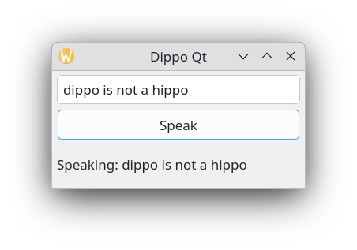
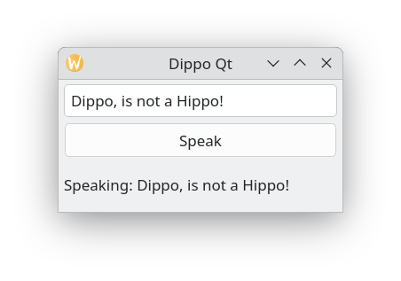

# Dippo: A Diphone Speech Synthesiser

Dippo is a lightweight concatenative diphone speech synthesiser.

A screenshot of Dippo is shown below.



This current version has been rewriiten from scratch using C++ 17 and uses Qt6 for a simple graphical user interface.

The long-term goal of the project is to serve as a high-clarity, context-aware audio announcement subsystem for the [Talk Calendar](https://github.com/crispinprojects/talkcalendar) project.

## Technical Overview & Core Concepts

Dippo is built completely from scratch using a concatenative diphone layout:

• **Phonemes vs. Diphones:** A phoneme is the smallest unit of sound that distinguishes one word from another (English features 44 baseline phonemes). Phonemes capture "steady-state" sounds. A diphone is a sound unit composed of two adjacent partial phonemes i.e. the second half of the first phoneme and the first half of the second phoneme and so captures the acoustic transition from the middle of one phoneme to the middle of the next. The synthesizer uses a set of pre-recorded diphone sound samples and concatenates diphone audio to produce speech output for a given text input.

• **Coarticulation Handling:** The most complex part of synthetic speech is the boundary transition between sounds. By recording these transitions (diphones) and "gluing" them together at the stable, stationary centres of phonemes, Dippo achieves a much more natural speech flow than basic phoneme playback as used in my [TOM](https://github.com/crispinprojects/tom) project.

• **Phonetic Matrix:** With 44 phonemes, there are theoretically \(44^2 = 1,936\) possible diphone permutations. Because many transitions never occur naturally in English, Dippo utilizes a streamlined collection of approximately 1,600 standard diphones.

• **Syllable-Free Synthesis:** Unlike alternative syllable-based engines (such as the [TOM](https://github.com/crispinprojects/tom) speech processor), Dippo handles phonetic transitions mid-syllable natively through predefined phoneme boundary cuts, eliminating the need for complex runtime syllable segmentation algorithms.

## Project Structure & Architecture

Source Directory Layout

```
dippo/
├── main.cpp            # Application entry point
├── mainwindow.cpp      # Qt6 GUI
├── mainwindow.h    
├── sanitizer.cpp       # Text ormalisation and number expansion
├── sanitizer.h        
├── dictionary.cpp      # Lookup word diphone mapping and Grapheme-to-Phoneme engine
├── g2p_engine.h        
├── diphone.cpp         # Embedded audio waveform data and acoustic indexing arrays
├── diphone.h           
├── synthesizer.cpp     # Overlap-add audio concatenation and vocoder execution
├── synthesizer.h       
└── compile-and-run     # BASH script to build project
```

## Pipeline Chain

1. **GUI (mainwindow.cpp)**

The mainwindow.cpp file provides the Qt GUI. A QLineEdit is used for text entry and QPushButton to invoke the speech synthesizer.

2. **Text Processing (sanitizer.cpp)**

Implements preprocessing to clean input strings and expand numeric data before vocabulary matching:


3. **Dictionary (dictionary.cpp)**

Performs lookup of word diphone sequence mapping. 

If a word is not found in the dictionary, the Grapheme-to-Phoneme (G2P) engine is invoked. The G2P engine converts written spelling units (graphemes) into a sequence of phonemes that represents how the text should be pronounced. The phoneme sequence is then converted into a diphone sequence.

Grapheme-to-Phoneme predictive rule tree calculates pronunciation on the fly using a sliding window context:

```
char p = previous_char; // 1 character behind
char c = current_char;  // Target character
char n = next_char;     // 1 character ahead
char nn = char_2_ahead; // 2 characters ahead
char nnn = char_3_ahead;// 3 characters ahead
```

The  predict functions `predictA` through `predictZ` functions are the pronunciation rules.

**Example: predictA function**

```
std::string Dictionary::predictA(char p, char c, char n, char nn, char nnn) {
	(void)p; (void)c; (void)n; (void)nn; (void)nnn; // Suppress unused parameter warnings
    // 1. Magic E (Lake, Bake, Fate, Ale)
    if (n != '_' && nn == 'e' && nnn == '_') return "ey";

    // 2. Common Vowel Neighbours 
    if (n == 'i' || n == 'y') return "ey";
    if (n == 'r' || n == 'h' || n == 'w') return "aa";

    // 3. The "Apple" logic
    if (n == 'l' || n == 'p' || n == 'c' || n == 'd') return "ae";

    // 4. Fallback
    return "ae";
}
```

The patterns in the predict rules were learned from the [CMU Pronouncing Dictionary](http://www.speech.cs.cmu.edu/cgi-bin/cmudict#about)  which was used as the pronunciation corpus. This contains 134,000 words and their phoneme transcriptions. My CART-Based Grapheme-to-Phoneme (G2P) Rule Generator & Tester [project](https://github.com/crispinprojects/g2p-rule-generator) explains how I developed the G2P engine.

The G2P engine while not perfect always tries to achieve a pronunciation for a word not in the dictionary (unknown word).


4. **Synthesizer & Vocoder (synthesizer.cpp)**

The vocoder is the component responsible for taking a diphone sequence and generating the final audio samples. This C++ version of Dippo uses the  **overlap-add** (OLA) method to concatenate the recorded diphone raw audio units. OLA smooths the joins between recorded diphone units to eliminate audible clicks and digital discontinuities. At each diphone boundary join, it overlaps a short trailing tail of the outgoing unit with the opening segment of the incoming unit using complementary cross-fade windows.


## Compilation & Usage

## Prerequisites

Developed and tested on Debian 13 (Trixie). Requires standard compilation tools and ALSA utility packages:

```
sudo apt update
sudo apt install build-essential 
sudo apt install alsa-utils
```
You also need to install cmake and the Qt6 libraries.

```
sudo apt update
sudo apt install build-essential cmake ninja-build
sudo apt install qt6-base-dev qt6-base-dev-tools
```

## Building From Source

Compile the project using the compile-and-run.sh BASH script which should be located in the source code directory.

```
./compile-and-run


Building project...
[ 14%] Building CXX object CMakeFiles/dippo-qt.dir/main.cpp.o
[ 28%] Building CXX object CMakeFiles/dippo-qt.dir/mainwindow.cpp.o
[ 42%] Building CXX object CMakeFiles/dippo-qt.dir/sanitizer.cpp.o
[ 57%] Building CXX object CMakeFiles/dippo-qt.dir/synthesizer.cpp.o
[ 71%] Building CXX object CMakeFiles/dippo-qt.dir/dictionary.cpp.o
[ 85%] Building CXX object CMakeFiles/dippo-qt.dir/diphone.cpp.o
[100%] Linking CXX executable dippo-qt
[100%] Built target dippo-qt
Executing application...

```

## Practical Verification Examples


1. **Baseline Text and Pre-processing Verification**

Use a phrase line "Dippo, is not a Hippo!" to confirm that puncuations do not prevent speech.




2. **Automatic Date Transformation**

Use a phrase like "Friday 30th October" to confirm that 30th is expanded.


3. **Time**

With time entries there is a clash with "am" the verb and "am" meaning time A.M. 
Consequently there are two dictionary entries "am" and "amtime" to distinguish between the two cases.

Phrases like "the time is 11:47 amtime" and "the time is 10:40 pmtime" can be used.


4. **Unknown word (G2P Engine)**

When dippo encounters a word not in the dictionary (unknown word) it uses the G2P engine to predict its pronunciation. The word "London"  is not in the dictionary and so is an unknown word. Use the phrase "Visit London" to check how the G2P engine pronounces the word London


## License

Distributed under the **GNU General Public License v3.0**.

## Author

* **Alan Crispin** [Github](https://github.com/crispinprojects)


## Project Status

Active.

## Acknowledgements

* Acoustic Data: Uses the public base [diphone collection](https://github.com/hypnaceae/DiphoneSynth/blob/master/diphones_license.txt) compiled by Professor Alan W Black and Kevin Lenzo.

* Diphone collection and synthesis Alan W. Black and Kevin Lenzo [2000](https://www.cs.cmu.edu/~awb/papers/ICSLP2000_diphone.pdf)

* [Speech Synthesis](https://www.youtube.com/watch?v=eDjtEsOvouM&t=1459s) CMU Low resource NLP Bootcamp 2020  *Author:* Professor Alan W Black 

* Development managed using the [Kate](https://apps.kde.org/en-gb/kate/) source code editor

* [Talk Calendar](https://github.com/crispinprojects/talkcalendar)


